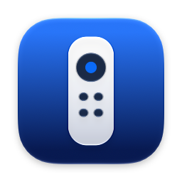
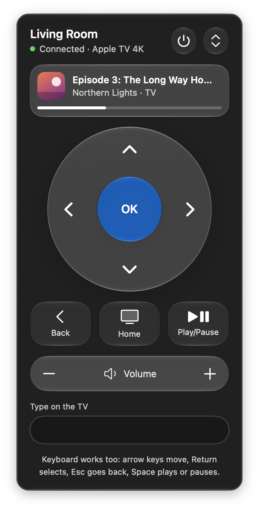
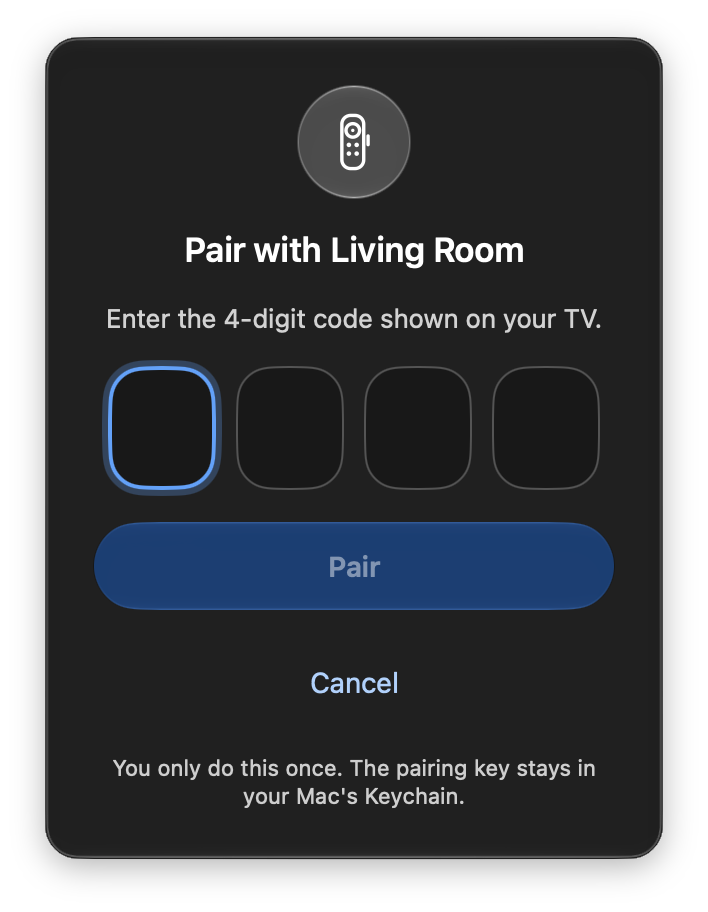
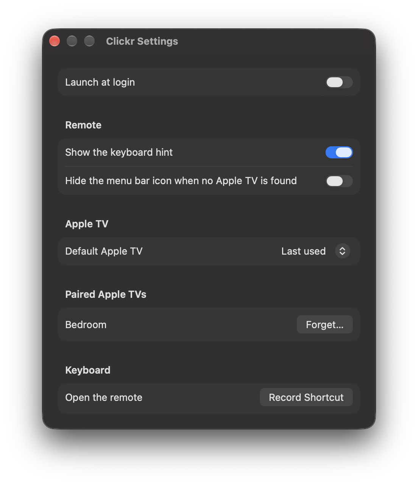
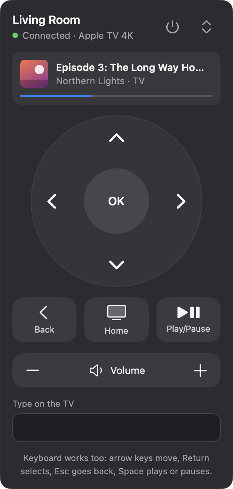

<p align="center">
  
</p>

<h1 align="center">Clickr</h1>

<p align="center"><strong>A menu bar remote for Apple TV.</strong><br>
Control your Apple TV from your Mac, just like the Remote in Control Center on iPhone.</p>

<p align="center">
  
</p>

---

Clickr lives in your menu bar. Click the little remote, and you get a full Apple TV remote: a clickpad, Back, Home, Play/Pause, volume, a text box for typing into search fields, and a card showing what's playing. You can also drive it entirely from your keyboard.

It's free and open source. It talks to your Apple TV directly over your home network, with no accounts, no cloud and no tracking. The only other thing it ever contacts is GitHub, to check for new versions, and only if you say yes.

## Features

- **The whole remote:** clickpad with arrows and OK (swipe across it too), Back, Home, Play/Pause, and volume up and down.
- **Keyboard control:** arrow keys, Return, Esc, Space and more while the remote is open, plus an optional global shortcut to open it from anywhere.
- **Type on the TV:** fill in search and sign-in fields from your Mac's keyboard instead of pecking at an on-screen keyboard.
- **Now playing:** title, show or artist, app, artwork and a live progress bar for whatever's on.
- **Power:** hold the power button to put the TV to sleep or wake it up.
- **Several Apple TVs:** switch between them from the remote, and pick which one Clickr starts with.
- **Looks at home on your Mac:** Liquid Glass on macOS 26 and later, and a classic dark look on macOS 14 and 15.
- **Quick and private:** connects directly over your home network and keeps its pairing key in your Mac's Keychain.
- **Update checks:** optionally checks GitHub once a day and tells you when a new version is out.

## Requirements

- A Mac running **macOS 14 Sonoma or later** (Apple silicon or Intel).
- An **Apple TV HD or Apple TV 4K** on the same network as your Mac.
- Tested with an Apple TV 4K running tvOS 26.

## Installing

1. Download the latest release from the [Releases](../../releases) page. There are two zips:
   - **Clickr-x.y.z-universal.zip** runs on every Mac (Apple silicon and Intel). Pick this one if you're not sure.
   - **Clickr-x.y.z-arm64.zip** is a smaller download for Apple silicon Macs (M1 and later) only.
2. Unzip it and drag **Clickr** into your **Applications** folder.
3. Open Clickr. A remote icon appears in your menu bar (Clickr has no Dock icon).

### "Apple could not verify Clickr…"

Clickr is a free hobby project, so it isn't signed with a paid Apple Developer ID. The first time you open it, macOS will say it can't check it for malware. That's expected, and you only have to deal with it once:

- **macOS 15 Sequoia and later:** click **Done** on the warning, then open **System Settings > Privacy & Security**, scroll down, and click **Open Anyway** next to the message about Clickr. Confirm, and Clickr opens.
- **macOS 14 Sonoma:** right-click (or Control-click) Clickr in Applications, choose **Open**, then click **Open** again.

If you'd rather check the code yourself first, it's all here, and you can [build it from source](#building-from-source).

### Update checks

Shortly after the first launch, Clickr asks whether it should **check for updates automatically**. If you say yes, it asks GitHub about once a day whether there's a newer release. When there is, you'll see **Update Available** at the top of the right-click menu and in Settings, and clicking it opens the release page so you can download it. Clickr never downloads or installs anything by itself.

### Allow local network access

When Clickr first looks for your Apple TV, macOS asks whether it may find devices on your local network. Click **Allow**. Without it, Clickr can't see your TV. (You can change this later in **System Settings > Privacy & Security > Local Network**.)

## Pairing with your Apple TV

You pair once per Apple TV, a bit like pairing a new Siri Remote.

<p align="center">
  
</p>

1. Make sure your Mac and Apple TV are on the same Wi-Fi or network.
2. Click the Clickr icon in the menu bar. Clickr finds your Apple TV and shows the pairing screen.
3. A **4-digit code** appears on your TV. Type it into Clickr and click **Pair**.
4. If macOS asks whether Clickr may use your Keychain, choose **Always Allow**. That's where Clickr keeps the pairing key.

That's it. From now on Clickr connects by itself whenever it starts. Your TV lists Clickr under **Settings > Remotes and Devices**, like any other remote.

Typed the wrong code? The boxes give a little shake and your TV shows a fresh code to try again.

## Using Clickr

Click the remote icon in the menu bar to open Clickr.

- **Clickpad:** click the arrows, or click and drag across the pad to swipe. **OK** selects; hold it to long-press.
- **Back** goes back (it's the Menu button). **Home** goes to the Home screen; hold it to open Control Center on the TV.
- **Play/Pause** does what it says.
- **Volume:** click **+** or **-**, or hold to keep going. This works if your Apple TV is set up to control your TV's or receiver's volume.
- **Power:** hold the power button at the top for a second. A ring fills up, then the TV goes to sleep (or wakes up). While it's asleep, the status line says **Connected · Asleep**, and pressing any button wakes it too.
- **Type on the TV:** when a search or text field is open on your TV, click the text box and type. The text appears on the TV as you go. Press **Esc** to hand the keyboard back to the remote. The box clears itself when the TV's keyboard goes away.
- **Switch Apple TVs:** if you have more than one, use the switcher at the top right.

### Now playing

When something is playing, a card appears at the top showing the title, who it's by or which show it's from, the app, artwork and a progress bar. It hides itself when nothing is playing.

Artwork comes from the app that's playing. Many apps (like Spotify and Apple's TV app) share it; some (like YouTube) don't, and you'll see a simple play symbol instead.

### Keyboard shortcuts

These work while the remote is open:

| Key | Does |
|---|---|
| ↑ ↓ ← → | Move (hold to keep moving) |
| Return | Select (OK) |
| Esc | Back |
| Space | Play or pause |
| ⌘↑ / ⌘↓ | Volume up / down |
| H | Home |

You can also set a **global shortcut** in Settings to open the remote from any app.

### The right-click menu

Right-click (or Control-click) the menu bar icon for **Settings…** and **Quit Clickr**. When a new version is out, **Update Available** shows up there too.

## Settings

Right-click the menu bar icon and choose **Settings…**.

<p align="center">
  
</p>

- **Launch at login:** start Clickr when you log in.
- **Show the keyboard hint:** show or hide the shortcut reminder at the bottom of the remote.
- **Hide the menu bar icon when no Apple TV is found:** keeps your menu bar tidy when you're away from home. While it's hidden, open Clickr again from Applications to get back to Settings.
- **Default Apple TV:** start with the TV you used last, or always a specific one.
- **Paired Apple TVs:** see which TVs Clickr is paired with, and **Forget** one if you want to.
- **Open the remote:** record a global keyboard shortcut (it needs ⌘, ⌥ or ⌃).
- **Updates:** turn automatic update checks on or off, see whether you're up to date, check now, or download a new version.

## On macOS 14 and 15

On macOS before Tahoe, Clickr uses a classic dark design instead of Liquid Glass. It does all the same things. You'll also get this look on newer macOS if you turn on **Reduce Transparency** in Accessibility settings.

<p align="center">
  
</p>

## Troubleshooting

**Clickr says "No Apple TV found."**
Check that your Mac and Apple TV are on the same network, that the Apple TV is plugged in, and that Clickr is allowed under **System Settings > Privacy & Security > Local Network**. Guest networks and some mesh or business networks block devices from seeing each other.

**It says "Not connected · Retry."**
Clickr keeps retrying on its own, but you can click **Retry** to try right away. If your TV was unplugged or lost its network, give it a moment after it's back.

**It says "Connected" but my TV is off.**
That's normal. An Apple TV that's "off" is really asleep and stays on the network, which is how remotes can wake it. Clickr shows **Connected · Asleep** when the TV says it's sleeping, and any button press wakes it.

**macOS keeps asking about the Keychain after I update Clickr.**
Because Clickr isn't signed with a Developer ID, macOS sees each new version as a slightly different app and asks again before it can read the pairing key. Choose **Always Allow**. It doesn't affect your pairing.

**The pairing screen showed up again.**
That happens if the Apple TV forgot Clickr (for example after a reset, or if Clickr was removed under **Remotes and Devices** on the TV). Just pair again with the new code.

**There's no now playing card.**
It only appears while something is playing or paused with something loaded. If you just connected, give it a few seconds.

**Volume buttons don't change the volume.**
Clickr sends the same volume command as the Siri Remote, so it works when your Apple TV controls your TV's or receiver's volume (through HDMI-CEC or IR). Check **Settings > Remotes and Devices > Volume Control** on the Apple TV.

**"Couldn't reach GitHub" next to updates.**
Your Mac was offline or GitHub was unreachable. Clickr tries again later, or you can click **Check Now**. The remote itself doesn't need the internet.

**How do I remove Clickr completely?**
In Clickr's Settings, **Forget** each Apple TV, then quit Clickr and drag it to the Trash. On each Apple TV, remove Clickr under **Settings > Remotes and Devices**.

## Privacy

Clickr talks to your Apple TV directly over your local network. It has no accounts, no analytics and no crash reporting.

The only time it uses the internet is the optional update check. If you turn it on, Clickr asks GitHub's public API (`api.github.com`) about once a day for the latest Clickr release. Like any web request, that tells GitHub your IP address; the only thing about the app it sends is a "Clickr" User-Agent with the version number. Nothing about you, your Mac or your Apple TV is included. You can turn it off anytime in Settings.

What Clickr stores: the pairing key for each Apple TV (in your Mac's Keychain) and a few preferences.

## How it works

Clickr speaks Apple's **Companion** protocol, the same one the iPhone's Remote uses:

- **Pairing** uses HomeKit-style pair-setup: SRP-6a with a 3072-bit group and SHA-512 to prove both sides know the code, then an exchange of long-term Ed25519 keys.
- **Every connection** starts with pair-verify (X25519 key agreement plus Ed25519 signatures), after which every message is encrypted with ChaCha20-Poly1305.
- **Messages** are encoded in OPACK, Apple's compact binary format. Button presses are HID commands; typing uses Apple's remote text input archives.
- **Now playing** comes over a second connection: an AirPlay 2 remote-control session that tunnels MediaRemote (MRP) protobuf messages. The TV accepts the same pairing, so there's no second code.

Everything is written from scratch in Swift using only Apple's frameworks (SwiftUI, Network, CryptoKit, Security). There are no third-party packages. The protocol work lives in a separate Swift package, `CompanionKit`, which has no UI code and is covered by unit tests.

Clickr wouldn't exist without [pyatv](https://github.com/postlund/pyatv), the excellent open-source Python library for Apple TVs. Its documentation and source were the reference for the protocol details, and it was used during development (never in the app) to generate test vectors, so Clickr's encoders and decoders are checked byte for byte against it.

## Building from source

You'll need **Xcode 26 or later** (for the Liquid Glass APIs and the Icon Composer icon).

```bash
git clone https://github.com/ziggy46/Clickr.git
cd Clickr
open Clickr.xcodeproj
```

Then pick the **Clickr** scheme and run. Local builds are ad-hoc signed, so after each rebuild macOS asks about the Keychain again; choose Always Allow.

To run the protocol tests:

```bash
cd Packages/CompanionKit
swift test
```

<details>
<summary>More for developers</summary>

- **Project file:** `Clickr.xcodeproj` is generated from `project.yml` with [XcodeGen](https://github.com/yonaskolb/XcodeGen). The generated project is checked in, so you only need XcodeGen if you change `project.yml`.
- **Layout:** `App/` is the SwiftUI app (views, view model, settings). `Packages/CompanionKit/` holds the protocol stack, one module per layer: OPACK, TLV8, BigInt, SRP, Pairing, Transport, Discovery, Store, Session, Plist, MRP and AirPlay.
- **Test vectors:** `scripts/gen_vectors.py` regenerates the JSON vectors in the test targets using pyatv. It's only needed if you change it:
  ```bash
  python3 -m venv .venv && .venv/bin/pip install pyatv
  .venv/bin/python scripts/gen_vectors.py
  ```
- **Real-TV tests:** the `IntegrationTests` target runs against a real Apple TV when you set `CLICKR_TV_HOST` (and `CLICKR_TV_PORT`); otherwise it's skipped.
- **Builds and releases:** `.github/workflows/build.yml` runs the tests and builds the arm64 and universal zips on every push. Pushing a tag like `v1.2.0` builds that version and creates a **draft** release with both zips and their SHA-256 checksums; publish it when it looks right. Clickr's update check only sees published releases.
- **Debug previews:** debug builds accept `-ClickrPreviewState`, `-ClickrPreviewDesign`, `-ClickrPreviewNowPlaying` and friends to show any screen with sample data. See `App/PreviewSupport.swift`.
- **Design notes:** `BUILD_PLAN.md` is the original spec, with notes on every protocol detail that was checked or corrected along the way.

</details>

## Credits and license

Clickr is released under the [MIT License](LICENSE).

Thanks to [pyatv](https://github.com/postlund/pyatv) (MIT licensed) for documenting the protocols this app relies on.

Clickr is an independent project and isn't affiliated with or endorsed by Apple. Apple TV, AirPlay, Siri Remote and macOS are trademarks of Apple Inc.
